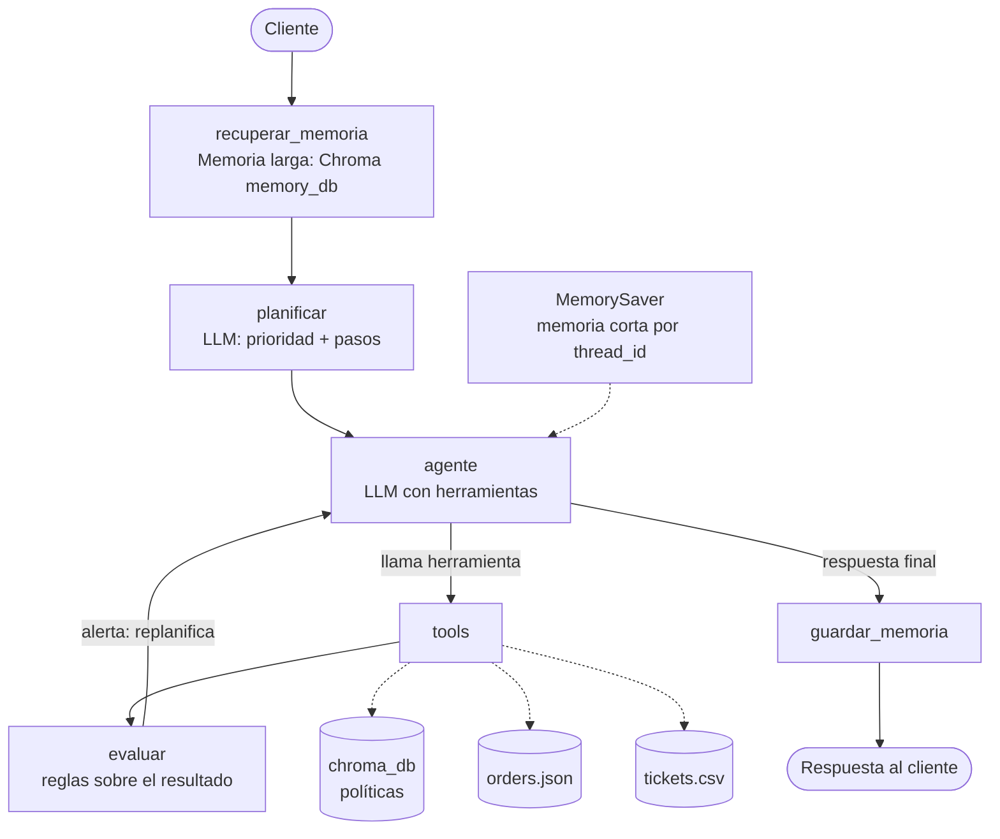

# Prismatic Watch AI

Agente de atención al cliente para Prismatic Watch, una tienda de relojes en línea. Consulta políticas con RAG, revisa pedidos, evalúa plazos, crea tickets de soporte y recuerda a cada cliente entre sesiones.

Proyecto de la asignatura ISY0101 - Ingeniería de Soluciones con IA.

- **Evaluación Parcial N°1:** chatbot RAG (`src/chatbot.py`).
- **Evaluación Parcial N°2:** agente funcional con herramientas, memoria y planificación (`src/agent/`, `src/main.py`).

## Caso organizacional

Un cliente escribe por un problema (cambio, devolución, garantía, envío, cuidado del reloj). El agente debe decidir qué información necesita, consultarla, evaluar si el caso procede y, si no puede resolverlo, escalarlo a soporte humano con una prioridad.

## Arquitectura



El flujo está implementado como un grafo de estados con LangGraph (`src/agent/graph.py`). Cada turno recorre los nodos en este orden:

1. **recuperar_memoria:** busca en la memoria larga los recuerdos del cliente más parecidos a su consulta.
2. **planificar:** el LLM define la prioridad (alta, media o baja) y una secuencia corta de pasos.
3. **agente:** el LLM decide qué herramienta llamar o si ya puede responder.
4. **tools:** ejecuta la herramienta elegida.
5. **evaluar:** inspecciona el resultado y, si hay un problema, inyecta una alerta y devuelve el control al agente (replanificación).
6. **guardar_memoria:** guarda un resumen del turno para futuras sesiones.

## Componentes

### Herramientas (`src/agent/tools.py`)

| Tipo | Herramienta | Función |
|---|---|---|
| Consulta | `buscar_politicas` | Búsqueda semántica en `chroma_db` (políticas y guía de cuidado). Descarta resultados lejanos con un umbral de distancia. |
| Consulta | `consultar_pedido` | Lee un pedido simulado desde `data/orders.json`. |
| Razonamiento | `evaluar_elegibilidad` | Calcula los días transcurridos y decide si el caso está dentro del plazo. |
| Escritura | `crear_ticket` | Registra un ticket con prioridad en `data/tickets.csv`. |

### Memoria (`src/agent/memory.py`)

- **Corta:** historial de la conversación por `thread_id` mediante `MemorySaver` de LangGraph, recortado a los últimos 20 mensajes.
- **Larga:** colección `memoria_clientes` en Chroma (`memory_db/`), separada de la base de políticas. Guarda por cliente un resumen con la consulta, las herramientas usadas, el resultado del plazo y los tickets creados. Se recupera por similitud semántica filtrando por cliente.

### Planificación y toma de decisiones

- El planificador asigna prioridad y pasos en cada turno.
- El nodo `evaluar` ajusta el comportamiento según los resultados:

| Resultado de la herramienta | Reacción del agente |
|---|---|
| `SIN_RESULTADOS` | Reformula la consulta (hasta 2 reintentos). Si persiste, escala con ticket y no inventa. |
| `PEDIDO_NO_ENCONTRADO` | Pide al cliente verificar el número de pedido. |
| `FUERA_DE_PLAZO` | Explica el motivo y crea un ticket para revisión humana. |
| `FECHA_INVALIDA` | Corrige el formato y reintenta. |

## Instalación

Requisitos: **Python 3.12** (las versiones fijadas no funcionan con Python 3.14) y una API key de Google Gemini (https://aistudio.google.com/apikey).

```bash
git clone https://github.com/Axelito777/prismatic-watch-ai.git
cd prismatic-watch-ai
python3.12 -m venv venv
source venv/bin/activate        # en fish: source venv/bin/activate.fish
pip install -r requirements.txt
```

### Configuración

Copia `.env.example` a `.env` y completa los valores:

```
GOOGLE_API_KEY=tu_api_key_aqui
MODEL_NAME=gemini-3.5-flash-lite
```

## Ejecución

1. Generar la base vectorial de políticas (solo la primera vez o si cambian los documentos):

   ```bash
   python src/ingest.py
   ```

2. Ejecutar el agente en modo interactivo:

   ```bash
   python src/main.py
   ```

   La consola muestra la memoria recuperada, el plan, las herramientas llamadas y las alertas del evaluador. Escribe `salir` para terminar.

3. Ejecutar un escenario de prueba y guardar su log en `tests/logs/`:

   ```bash
   python tests/run_scenarios.py <1-6>
   ```

   Para el escenario 6 (memoria entre sesiones), ejecuta antes el escenario 3.

## Pruebas

| N° | Escenario | Comportamiento esperado |
|---|---|---|
| 1 | Consulta simple de despacho | Una sola búsqueda, prioridad baja, sin ticket. |
| 2 | Cambio dentro de plazo (ORD-1001) | Pedido, elegibilidad y respuesta positiva. |
| 3 | Devolución fuera de plazo (ORD-1002) | Detecta `FUERA_DE_PLAZO` y crea ticket. |
| 4 | Pedido inexistente (ORD-9999) | Pide verificar el número, sin ticket. |
| 5 | Pregunta fuera de tema | Reformula, reintenta y escala sin inventar. |
| 6 | Caso anterior del mismo cliente | Recupera de la memoria larga el caso y el ticket. |

Los logs de cada ejecución están en `tests/logs/`.

## Estructura del proyecto

```
prismatic-watch-ai/
├── data/
│   ├── policies/            # Documentos fuente (políticas + guía de cuidado)
│   ├── orders.json          # Pedidos simulados
│   └── tickets.csv          # Tickets generados por el agente
├── src/
│   ├── agent/
│   │   ├── tools.py         # Herramientas
│   │   ├── memory.py        # Memoria corta y larga
│   │   ├── graph.py         # Grafo LangGraph, planificador y evaluador
│   │   └── prompts.py       # Prompts del sistema y del planificador
│   ├── main.py              # CLI del agente (EP2)
│   ├── chatbot.py           # Chatbot RAG (EP1)
│   ├── ingest.py            # Carga de documentos y creación de la base vectorial
│   └── debug_retrieval.py   # Diagnóstico de recuperación
├── tests/
│   ├── run_scenarios.py     # Ejecuta y registra los escenarios
│   ├── calibrar_umbral.py   # Calibración del umbral de distancia
│   └── logs/                # Evidencia de pruebas
├── docs/                    # Diagramas y bocetos
├── requirements.txt
├── .env.example
└── README.md
```

## Decisiones de diseño

> **Sección para completar por el equipo.** Explicar con sus propias palabras:
> - Por qué LangGraph frente a otras opciones (por ejemplo, la cadena fija de la EP1).
> - Por qué separar la memoria larga de la base de políticas.
> - Por qué un nodo evaluador con reglas en vez de dejar todo al LLM.
> - Cómo se calibró el umbral de distancia (ver `tests/calibrar_umbral.py`).

## Limitaciones

- Los pedidos y los plazos son datos simulados para el caso de estudio.
- El plan gratuito de Gemini limita las llamadas diarias y por minuto, y cada turno del agente usa varias llamadas.
- El umbral de distancia se calibró con pocas consultas.

## Declaración de uso de IA

> **Completar por el equipo:** indicar qué herramientas de IA se usaron y para qué (por ejemplo, apoyo en código, diagramas o redacción), según las indicaciones de la evaluación.

## Referencias

> **Completar en formato APA:** documentación de LangChain, LangGraph, ChromaDB, Sentence-Transformers y Google Gemini API.

## Integrantes

- Axel Subiabre
- Matias Molina