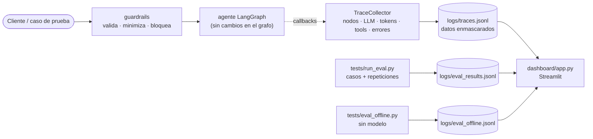

# Observabilidad del agente (EP3)

Este documento explica **qué se mide, cómo y con qué herramientas**. El análisis de los resultados
(hallazgos, patrones, recomendaciones) lo redacta el equipo en el informe a partir de lo que muestre el dashboard.

## Arquitectura de la trazabilidad



`ejecutar_turno()` (`src/observability/tracer.py`) envuelve cada turno: aplica los guardrails, ejecuta el agente con un
`TraceCollector` (callback de LangChain, por lo que no se modifica el grafo) y escribe **un registro JSONL por turno**.
`main.py` y `run_eval.py` usan la misma función, así que el uso interactivo y las evaluaciones se miden igual.

## Métricas

| Métrica | Definición | Indicador |
|---|---|---|
| **Precisión** | Aciertos / ejecuciones válidas. Un caso acierta si cumple *todas* sus verificaciones (herramientas requeridas y prohibidas, texto esperado o prohibido, ticket, prioridad, bloqueo). Se informa con intervalo de confianza de Wilson 95 %. Las fallas de infraestructura (cuota, modelo no disponible) se excluyen y se reportan aparte. | IE1 |
| **Precisión de la búsqueda** | *hit@3* (¿algún fragmento recuperado contiene la respuesta?) y *rechazo correcto* de consultas fuera de dominio (efecto del umbral de distancia). Sin usar el modelo. | IE1 |
| **Consistencia** | Con ≥ 2 repeticiones del mismo caso: *acuerdo de decisión* (fracción que usó las mismas herramientas, mismo ticket y mismo estado), *estabilidad del acierto* y *similitud del texto* de las respuestas. | IE1 |
| **Frecuencia de errores** | Tasa de turnos en estado `error`, `degradado` (falló una llamada interna pero el agente siguió con un plan genérico) y `bloqueado`; errores por tipo (`cuota_diaria`, `cuota_rpm`, `modelo_no_disponible`, `presupuesto_llm`, `herramienta_fallida`, …). | IE1 |
| **Latencia** | Segundos por turno (p50, p95), por nodo del grafo, por herramienta y por llamada al modelo; fracción del tiempo total que se espera al modelo. | IE2 |
| **Uso de recursos** | Llamadas al modelo por turno, tokens (entrada/salida), tiempo de CPU, memoria pico (RSS) y llamadas consumidas frente a la cuota diaria. | IE2 |

## Registro de un turno (`logs/traces.jsonl`)

`ts`, `run_id`, `lote`, `caso_id`, `categoria`, `repeticion`, `modelo`, `cliente` (seudónimo), `pregunta` y `respuesta`
(enmascaradas), `estado` (`ok` · `degradado` · `error` · `bloqueado`), `prioridad`, `latencia_total_s`, `nodos[]`,
`llm[]` (duración y tokens por llamada), `herramientas[]` (nombre, duración, código devuelto, argumentos enmascarados),
`llm_calls`, `tokens_*`, `cpu_s`, `rss_mb`, `alertas[]` (ajustes del evaluador), `ticket`, `reintentos_busqueda`, `errores[]`.

## Cómo ejecutarlo

```bash
pip install -r requirements.txt

# 1) Sin gastar cuota del modelo: herramientas + búsqueda semántica
python tests/eval_offline.py

# 2) Con el modelo (cuota gratuita ≈ 20 llamadas/día por modelo)
python tests/run_eval.py --dry-run                      # estima el costo, no llama al modelo
python tests/run_eval.py --nucleo --repeticiones 2 --lote eval1
python tests/run_eval.py --nucleo --repeticiones 2 --lote eval1   # al día siguiente: continúa donde quedó

# 3) Visualizar
streamlit run dashboard/app.py

# Pruebas del código de observabilidad (no usan API ni internet)
python -m pytest tests/unit -q
```

`run_eval.py` fija una **fecha de referencia** (`FECHA_REFERENCIA=2026-10-20`) para que los plazos no cambien con el
día en que se ejecuta, usa una **memoria temporal** por ejecución (no contamina `memory_db`) y escribe sus tickets en
`logs/eval_tickets.csv` (no toca `data/tickets.csv`).

## Evidencia "antes y después"

Para mostrar hallazgos y correcciones (IE3 e IE6): ejecuta `python tests/eval_offline.py` y guarda la salida
**antes** de aplicar las correcciones; luego corrige, vuelve a ejecutar y compara.

## Límites que conviene declarar en el informe

- Las verificaciones de texto son heurísticas (palabras clave): un acierto no prueba que la respuesta sea perfecta y un
  fallo puede ser una paráfrasis válida. Revisen los casos que fallen antes de concluir que el agente se equivocó.
- Con pocas repeticiones, los porcentajes son poco estables: por eso se reporta el intervalo de Wilson y el `n`.
- La latencia depende de la red y de la carga de la API, no solo del código; compárenla dentro de un mismo lote y modelo.
- La cuota gratuita limita cuántas ejecuciones caben por día; el costo estimado de cada caso está en `tests/eval_cases.json`.

## Preguntas guía para el análisis (IE3 e IE6)

1. ¿Qué nodo concentra la latencia y cuántas llamadas al modelo hace un turno frente a las que realmente hacen falta?
2. ¿Qué casos toman decisiones distintas entre repeticiones? ¿Qué tienen en común?
3. ¿Qué turnos quedaron `degradados` y qué habría pasado sin el plan de respaldo?
4. ¿Qué verificaciones fallan más y a qué categoría de caso corresponden?
5. ¿Qué consultas cerca del umbral de distancia se clasifican mal?
